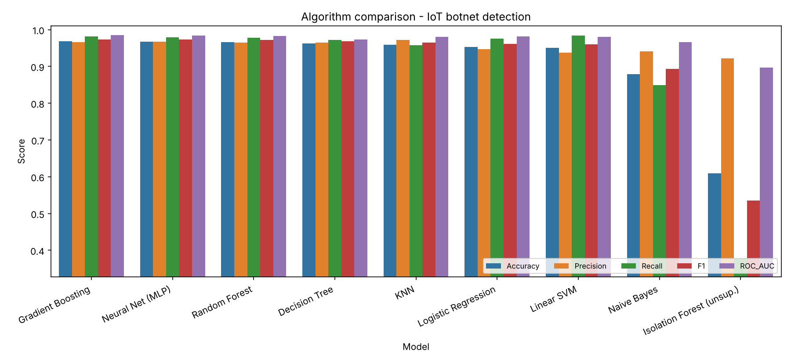
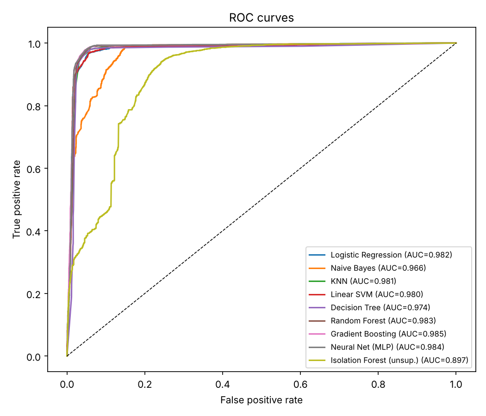
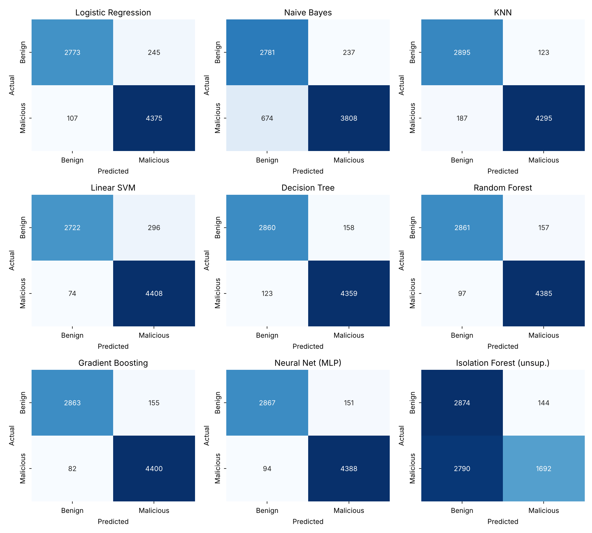
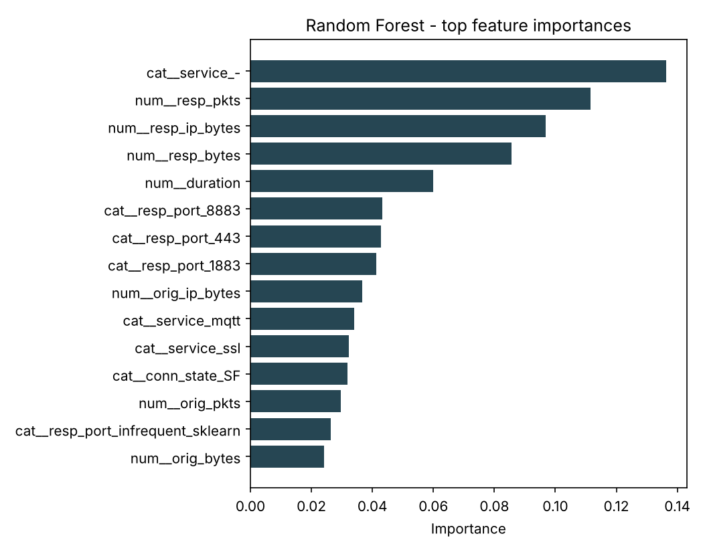

# IoT Network Anomaly Detection using Machine Learning

**Exp 7 – Intrusion Detection System (CSL-I05)**
Train ML models on IoT-23-style network flows to detect botnet traffic and compare the algorithms.

> Student: Gaurav Gupta (23ESKCY017)

## Objective
Build an Intrusion Detection System (IDS) that classifies IoT network flows as **Benign** or **Malicious (botnet)**, and compare the performance of multiple ML algorithms.

## Dataset
- **IoT-23** (Stratosphere Lab) – Zeek `conn.log.labeled` flows from real IoT devices infected with Mirai, Okiru, Torii, etc. and benign captures.
- By default (no data supplied) the script generates **synthetic IoT-23-like flows** (benign: HTTP/TLS, DNS, MQTT, NTP, flaky devices; malicious: port scan, telnet brute-force, C&C beaconing, DDoS flood, malware download) so the project runs out-of-the-box.
- The results in this repo come from the **synthetic data**. To reproduce on real data, download IoT-23 (https://www.stratosphereips.org/datasets-iot23) and pass the `conn.log.labeled` files with `--data`.

## Features used
`duration, orig_bytes, resp_bytes, orig_pkts, resp_pkts, orig_ip_bytes, resp_ip_bytes` (numeric, log-scaled + standardised) and `proto, service, conn_state, resp_port` (one-hot encoded).

## Algorithms compared
Logistic Regression · Naive Bayes · KNN · Linear SVM · Decision Tree · Random Forest · Gradient Boosting · Neural Net (MLP) · Isolation Forest (unsupervised, trained on benign traffic only)

## Run
```bash
pip install -r requirements.txt

# synthetic data (default)
python iot_ids.py

# real IoT-23 data
python iot_ids.py --data path/to/conn.log.labeled
```
Options: `--samples N`, `--max-rows N`, `--test-size 0.25`, `--seed 42`, `--out results`.

## Results (synthetic data, 75/25 stratified split)

| Model | Accuracy | Precision | Recall | F1 | ROC-AUC |
|---|---|---|---|---|---|
| Gradient Boosting | 0.9684 | 0.9660 | 0.9817 | 0.9738 | 0.9849 |
| Neural Net (MLP) | 0.9673 | 0.9667 | 0.9790 | 0.9728 | 0.9845 |
| Random Forest | 0.9661 | 0.9654 | 0.9784 | 0.9719 | 0.9827 |
| Decision Tree | 0.9625 | 0.9650 | 0.9726 | 0.9688 | 0.9735 |
| KNN | 0.9587 | 0.9722 | 0.9583 | 0.9652 | 0.9810 |
| Logistic Regression | 0.9531 | 0.9470 | 0.9761 | 0.9613 | 0.9815 |
| Linear SVM | 0.9507 | 0.9371 | 0.9835 | 0.9597 | 0.9798 |
| Naive Bayes | 0.8785 | 0.9414 | 0.8496 | 0.8932 | 0.9663 |
| Isolation Forest (unsup.) | 0.6088 | 0.9216 | 0.3775 | 0.5356 | 0.8972 |

Full console log: [`output.txt`](output.txt) · metrics: [`results/metrics.csv`](results/metrics.csv)

### Plots
| | |
|---|---|
|  |  |
|  |  |

## Observations
- **Gradient Boosting** gave the best F1 (0.974); tree ensembles and the MLP were close behind.
- Simple linear models (Logistic Regression, Linear SVM) are already strong and train in a fraction of a second – good for resource-constrained IoT gateways. Linear SVM had the highest recall (fewest missed attacks).
- **Naive Bayes** is weakest among supervised models (feature independence assumption does not hold for flow features).
- The **unsupervised Isolation Forest** (never sees attack labels) detects only ~38% of attacks – labelled training clearly helps, but it is useful when no labelled botnet data exists.
- Most important features: `service` = unknown, response packets/bytes, duration and destination port – scanning and DDoS flows have little/no response traffic.

## Project structure
```
iot_ids.py        # data loading, preprocessing, training, evaluation, plots
requirements.txt
output.txt        # console output of a run
results/          # metrics.csv + PNG plots
```

## Limitations / future work
- Reported numbers are on synthetic data; real IoT-23 results will differ (it is heavily imbalanced and multi-class in `detailed-label`).
- Extend to multi-class attack-type detection, add cross-validation, hyper-parameter tuning and time-window features.
